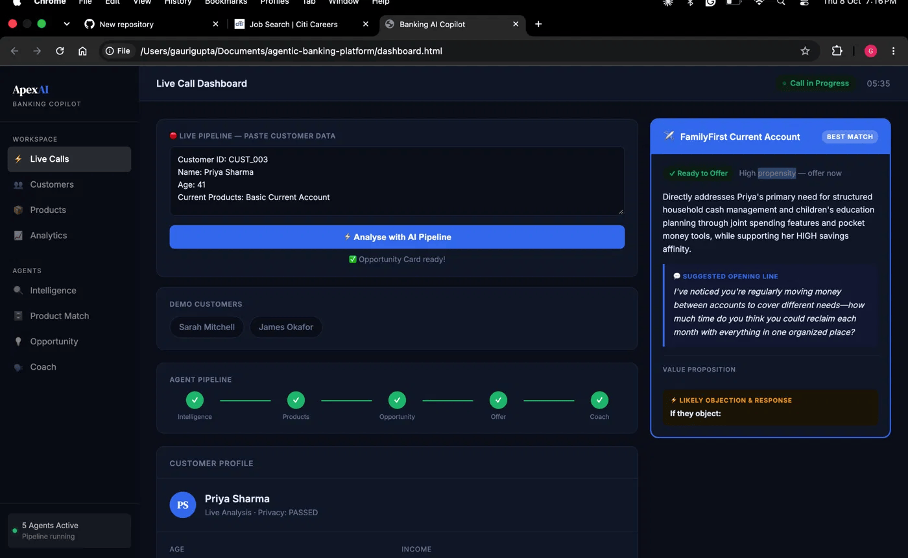

# Agentic AI Banking Customer Growth Platform

A multi-agent AI copilot that helps bank executives identify and act on customer growth opportunities in real time — during live calls.

## What it does

During a customer call, a bank executive pastes the customer's profile data. Five AI agents fire in sequence:

1. **Customer Intelligence Agent** — extracts behavioural signals and spending patterns
2. **Product Match Agent** — searches a vector database of bank products using semantic similarity
3. **Opportunity Discovery Agent** — identifies the highest-value growth opportunity
4. **Offer Construction Agent** — builds a tailored value proposition with benefits and objection handling
5. **Executive Coach Agent** — generates a privacy-safe personalised opening line

The result is a live Opportunity Card shown on the dashboard — ready before the executive even finishes their greeting.


## Tech stack

- **Claude claude-haiku** (Anthropic) — powers all 5 agents
- **ChromaDB** — vector database for semantic product search
- **FastAPI + uvicorn** — REST API connecting the UI to the pipeline
- **Vanilla HTML/CSS/JS** — professional dashboard UI with dark mode

## Project structure

agentic-banking-platform/
├── notebooks/
│ ├── customer_intelligence_agent.ipynb
│ ├── opportunity_discovery_agent.ipynb
│ └── banking_pipeline.ipynb
├── app.py # FastAPI backend
├── dashboard.html # Live call dashboard UI
├── .gitignore
└── README.md

## Setup

1. Clone the repo
2. Install dependencies:
```bash
   pip install anthropic chromadb fastapi uvicorn python-dotenv sentence-transformers
```
3. Create a `.env` file:
ANTHROPIC_API_KEY=your_key_here

4. Start the server:
```bash
   python -m uvicorn app:app --reload
```
5. Open `dashboard.html` in your browser

## Built by

Gauri Gupta · MSc Quantitative Finance 
